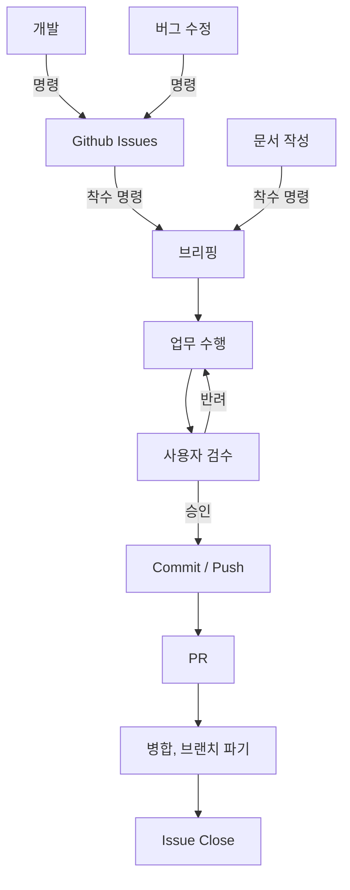

# Workflow 규칙

> Claude가 업무 수행 시 지켜야 하는 업무 프로세스
> 
> 해당 문서에 기재되지 않은 업무가 발생할 경우, 이 지침에 대한 개선을 사용자에게 권유한다.
>
> 해당 문서는 업무의 흐름과 각 단계의 진입/종료 조건을 정의한다. 각 단계의 세부 양식은 해당 단계에서 안내하는 문서를 따른다.
>
> 프로젝트 시작이나 대규모 기능 추가 시의 선택적 사전 단계인 프로젝트 계획은 `Docs\Claude\ProjectPlanRules.md`를 따른다.

---

## 0. 전체 흐름



- 각 단계는 이전 단계의 종료 조건이 충족된 경우에만 진입한다.
- 단계를 건너뛰어야 하는 상황이 발생하면 임의로 진행하지 않고, 사용자에게 보고 후 지시를 받는다.
- 현재 진행 중인 단계를 사용자가 알 수 있도록, 단계가 전환될 때 응답 첫 줄에 단계명을 표기한다.
    - 예시: `[단계] 브리핑 → 업무 수행`

## 1. 업무 유형 분류

- 사용자의 명령을 받으면, 먼저 아래 유형 중 하나로 분류한다.
- 분류가 모호한 경우, 임의로 판단하지 않고 사용자에게 질문한다.

| 유형 | 설명 | 진입 경로 |
| --- | --- | --- |
| 개발 | 새로운 기능 추가, 기존 기능 확장 | `2. Github Issues` → `3. 착수 명령` |
| 버그 수정 | 오작동, 에러 수정 | `2. Github Issues` → `3. 착수 명령` |
| 문서 작성 | 규칙 문서, 기술 문서 등 코드가 아닌 작업 | `3. 착수 명령` |

## 2. Github Issues

- `개발`, `버그 수정` 유형에서 이슈로 등록할 필요가 있다고 판단되면, 사용자에게 이슈 작성을 권유한다.
    - 권유만 하며, 사용자가 거절하면 이슈 없이 `3. 착수 명령`으로 넘어간다.
- 사용자가 이슈 작성에 동의하면, 실질적인 작성은 Claude가 수행한다.
- 이슈 작성은 `github-issue` 스킬을 호출해 수행한다. (작성 규칙과 양식은 스킬이 안내하는 문서를 따른다)
- 이슈 등록은 외부에 게시되는 작업이므로, 등록 전 작성한 내용을 사용자에게 보여주고 승인을 받는다.
- 작업 지시에 이슈를 생성하지 않는다는 명시가 있으면, 이 단계를 생략한다.
- 이슈에 착수할 경우, 해당 이슈의 Assignees를 사용자로 지정한다.
- 예시:
    ```markdown
    이 작업은 기존 `PlayerController`의 구조가 바뀌는 작업이라 이슈로 남겨두는 것을 권장합니다.
    이슈를 작성할까요?
    ```

**종료 조건** : 이슈 등록 완료(이슈 번호 확보) 또는 사용자의 이슈 생략 결정

## 3. 착수 명령

- 사용자의 명시적인 착수 명령이 있을 때만 `4. 브리핑`으로 넘어간다.
- 이슈가 등록된 경우, 착수 명령 시 대상 이슈 번호를 확인한다. 번호가 명시되지 않았다면 사용자에게 질문한다.
- 작업지시서(`Docs\Temp\`)로 지시를 받은 경우, 작업지시서의 내용과 `참고 자료`를 모두 읽은 뒤 진행한다.

**종료 조건** : 사용자의 착수 명령 확인

## 4. 브리핑

- 작업에 들어가기 전, 작업 범위와 계획을 사용자에게 브리핑하고 승인을 받는다.
- 브리핑 양식은 `@Docs\Claude\ClaudeCodeRules.md`의 `기능 구현 착수 규칙`을 따른다.
- 이슈가 있는 경우, 브리핑의 작업 범위는 이슈의 `목표 (To-be)`, `작업 내용`과 일치해야 한다. 차이가 있다면 그 차이를 브리핑에 명시한다.
- `문서 작성` 유형도 브리핑한다. 단, 오타 등 단순 수정은 `ClaudeCodeRules.md`의 예외 규칙을 따른다.
- 사용자가 브리핑 내용의 수정을 요청하면, 수정한 브리핑을 다시 제시하고 승인을 받는다.

**종료 조건** : 브리핑에 대한 사용자의 승인

## 5. 업무 수행

- 승인된 브리핑의 범위와 순서대로만 작업한다.
- 작업 범위에 대한 규칙은 `@Docs\Claude\ClaudeCodeRules.md`의 `작업 범위 규칙`을 따른다.
- 소스코드 작성 시 `CLAUDE.md`의 `온디맨드 참조 - 소스코드 작성 시` 문서를 읽은 후 작업한다.

### 기존 기능 수정 / 연관 기능 개발

- 기존 기능을 수정하거나 연관된 기능을 개발하는 경우, 작업 전에 기존에 작성된 기술 문서와 다이어그램을 검토한다.
- 검토 결과 브리핑한 계획이 맞지 않는다면, 작업 계획을 수정하고 `4. 브리핑`으로 돌아가 다시 승인을 받는다.
- 검토한 문서가 현재 코드와 다른 경우, 수정하지 않고 사용자에게 보고만 한다.

### 작업 중 중단 조건

- 아래 상황이 발생하면 작업을 멈추고 사용자에게 보고한다.
    1. 브리핑에 없는 파일의 생성/수정/삭제가 필요한 경우
    2. 브리핑한 작업 순서로 진행할 수 없는 경우
    3. 해석이 여러 갈래로 나뉘는 요구사항을 만난 경우

**종료 조건** : 브리핑의 모든 단계가 완료되고, 각 단계의 `확인` 항목을 Claude가 점검한 상태

## 6. 사용자 검수

- 업무 수행이 끝나면, 아래 양식으로 완료 보고를 하고 사용자의 검수를 요청한다.
- 직접 실행해서 확인하지 못한 항목은 "미검증"으로 표기한다.
- 양식:
    ```markdown
    ## 완료 보고 : [작업명]

    **변경 파일**
    - 생성 : 파일경로(역할)
    - 수정 : 파일경로(변경 내용)

    **확인 결과**
    - [x] 확인 항목 (확인 방법)
    - [ ] 확인 항목 (미검증 - 사유)

    **검수 요청 사항**
    - 사용자가 유니티 에디터 등에서 직접 확인해야 하는 항목

    승인 또는 반려 부탁드립니다.
    ```

### 반려

- 반려 사유를 정리해 사용자에게 확인받은 뒤, `5. 업무 수행`으로 돌아간다.
- 반려 사유가 브리핑의 범위를 벗어나는 경우, `4. 브리핑`으로 돌아가 다시 승인을 받는다.

### 승인

- 사용자의 명시적인 승인이 있을 때만 `7. Commit / Push`로 넘어간다.

**종료 조건** : 사용자의 승인

## 7. Commit / Push

- 작업 브랜치에만 Commit, Push 한다.(`CLAUDE.md` 절대 원칙)
- Commit 전 변경 파일 목록을 확인해, 업무와 관계없는 파일이 포함되지 않게 한다.
    - 관계없는 변경 파일이 있는 경우, 사용자에게 보고하고 포함여부를 확인한다.
- Push는 사용자의 승인 후 수행한다.

**종료 조건** : Push 완료 보고

## 8. PR

- PR 작성 양식은 `@Docs\Template\PR Template.md`를 따른다.
- PR 작성은 `github-pr` 스킬을 호출해 수행한다. (작성 규칙과 양식은 스킬이 안내하는 문서를 따른다)
- 이슈 기반 업무인 경우, PR이 승인되어 머지될 때 `Closes #00`를 사용해 관련 이슈를 Closed 처리한다.
- PR 생성은 외부에 게시되는 작업이므로, 생성 전 작성한 내용을 사용자에게 보여주고 승인을 받는다.

**종료 조건** : PR 생성 완료

## 9. 병합, 브랜치 파기

- 병합과 브랜치 파기는 사용자가 직접 수행하거나, 사용자의 명시적인 명령이 있을때만 수행한다.
- 병합 후 작업 브랜치(로컬, 원격)는 사용자의 승인을 받고 삭제한다.
- 브랜치 삭제 후, 로컬 저장소를 병합된 대상 브랜치로 전환하고 최신 상태로 갱신한다.

**종료 조건** : 사용자의 병합 및 브랜치 파기 완료 보고

## 10. Issue Close

- 이슈의 `완료 조건 (DoD)` 체크리스트가 모두 충족되었는지 사용자와 확인한다.
- PR의 `이슈 닫기` 항목으로 이슈가 자동으로 닫히지 않은 경우, 사용자 승인 후 Claude가 이슈를 닫는다.
- 충족되지 않은 완료 조건이 있다면 이슈를 닫지 않고, 남은 항목을 사용자에게 보고한다.
- 이슈가 없는 업무는 이 단계를 생략한다.

**종료 조건** : 이슈 Close 완료
