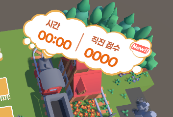

# Github PR 작성 규칙

> GitHub PR을 작성할 때의 규칙.
>
> PR 작성 양식은 `@Docs\Template\PR Template.md`를 참고.
>
> 해당 문서는 각 섹션에 대한 작성 규칙을 정의한다.

## 1. Title

[종류] 작업할 내용의 요약 제목
- 20자 이내로 적는다.
- 상세한 키워드가 아닌 `기능` 단위로 적는다.
- `[종류]` 에는 작업 종류에 따라 `[Feat], [Docs], [Fix], [Ref], [Chore], [Test]`로 나누어 기입
``` markdown
• [Feat](Feature): 새로운 기능이나 요구사항을 추가할 경우
• [Docs]: 규칙 문서, 기술 문서 등 문서를 추가하거나 수정할 경우
• [Fix](Bugfix): 코드의 버그나 오작동을 수정할 경우
• [Ref](Refactor): 기능의 동작은 바꾸지 않고 코드 구조나 가독성을 개선할 경우 (리팩토링)
• [Chore]: 빌드 업무 수정, 패키지 매니저 설정, 라이브러리 업데이트 등 프로덕션 코드와 직접 관련 없는 잡다한 작업일 경우
• [Test]: 테스트 코드를 추가하거나 기능을 시험할 경우
```
- 예시:
    ```markdown
    - [Feat] 플레이어 이동 구현
    - [Feat] 몬스터 피격판정 구현
    - [Fix] 플레이어 연속 점프 수정
    - [Docs] 일일 업무 일지 작성
    ```

## 2. 중점적으로 살펴볼곳

- 작업 내용 중 핵심부분을 적는다.
- 동작 중 버그나 오류가 생성될 수 있는 곳을 적는다.
- 예시:
    ```markdown
    ## 중점적으로 살펴볼곳

    - WASD 키 입력시 플레이어가 정상적으로 이동하는지 확인
    - 플레이어 이동시 벽이나 장애물을 무시하지 않는지 확인
    - 플레이어 점프시 공중에서 연속으로 점프하지 않는지 확인
    ```

## 3. 관련 이슈

- 연관된 이슈 번호를 기입
- 예시:
    ```markdown
    ## 관련 이슈
    
    - `#259`
    ```

## 4. 작업 내용

- 리스트로 작성하며, 특정 경로의 파일에 어떤 작업이 이뤄지는지 기재한다.
- 실제로 작업한 내용을 사용한 방식과 함께 간단히 기입한다.
- 예시:
    ```markdown
    ## 작업 내용

    - `Assets/Scripts/PlayerMovement.cs` 생성
    - `Assets/Scripts/GameManager.cs` 생성
    - RigidBody를 이용해 플레이어의 이동관련 기능 구현   
    - Singleton 패턴으로 GameManager 구현
    - Animator Controller로 플레이어의 이동 관련 애니메이션 적용
    ```

## 5. 구현 예시

- 작업한 내용을 설명 할 수 있는 이미지 등을 첨부한다.
- 예시:
    ```markdown
    ## 구현 예시

    - 점수 UI 이미지 첨부
    
    ```

## 6. 리뷰 요구 사항(선택)

- 구현 전 사용자에게 답변을 듣지 못해 임의로 처리하게 된 부분이 있으면 작성한다.
- 예시:
    ```markdown
    ## 리뷰 요구 사항

    - 플레이어 점프 구현중 공중 연속 점프 방지를 위해 Ray를 사용하는 방식이 맞는지 검토 요구
    - Ground Layer를 제외한 Bush Layer는 사용자가 통과할 수 있는 방식이 맞는지 확인 
    ```

## 7. 이슈 닫기

- 닫을 이슈 번호를 기입
- 예시:
    ```markdown
    ## 이슈 닫기
    
    - Closes #이슈번호
    ```